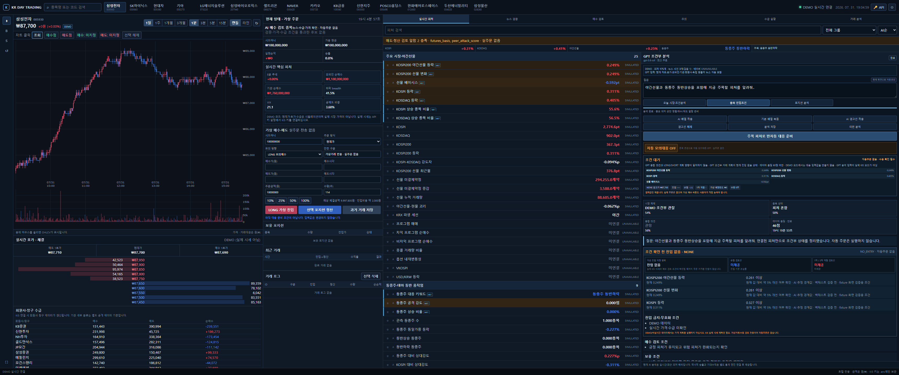

# KR Market Terminal

국내주식의 분봉, 호가, 수급, 뉴스와 공시를 한 화면에서 확인하는 로컬 웹 터미널입니다. 여러 원천의 값을 종목별로 모으고, 값의 출처와 미제공 상태를 함께 표시합니다.

*합성 시세와 뉴스로 구성한 기존 데모 화면입니다. 실제 시장 가격이나 투자 성과를 나타내지 않으며, 현재 화면과 일부 구성이 다를 수 있습니다.*

## 어떤 기능이 있나

- 15개 국내 종목의 가격·거래량 차트와 1/3/5/15분 리샘플
- 호가 5단계, 외국인·기관 수급, 증권사 회원사 창구 흐름
- 뉴스의 공식 원출처, 독립 출처, 재배포를 구분한 사건 목록
- 기술 지표, 재무·거시·업종 지표의 최신 스냅샷
- 선택적인 외부 LLM 해석, 임계값 경고, LONG/SHORT 가상거래 기록

실제 계좌 주문은 지원하지 않습니다. 뉴스 확인 점수는 승률이 아니며, 학습된 가격 예측 모델이나 통계 백테스트 엔진을 포함하지 않습니다.

## 빠르게 실행하기

Windows와 Python 3.11 이상을 기준으로 합니다. 첫 실행은 데모 모드로 권장합니다.

~~~powershell
python -m venv .venv
.\.venv\Scripts\python.exe -m pip install -r requirements.txt
Copy-Item .env.example .env
.\.venv\Scripts\python.exe -m uvicorn app:app --host 127.0.0.1 --port 8767
~~~

브라우저에서 http://127.0.0.1:8767 을 엽니다. 설정 예시는 합성 시세·뉴스를 사용하며 외부 분석 호출은 꺼져 있습니다. 데모 모드는 시장·뉴스 공급자를 외부에 요청하지 않습니다. 처음 표시되는 설정 창에서는 데모를 유지하려면 닫기/나중에 설정을 선택하세요. 공개 데이터로 전환하는 버튼을 누르면 이후 외부 조회가 발생할 수 있습니다.

Windows에서는 의존성을 준비한 뒤 RUN.cmd도 사용할 수 있습니다. launcher가 환경을 준비하면서 패키지 설치를 수행할 수 있으므로, 실행 과정을 직접 확인하려면 위 명령을 사용하세요.

## 실제 데이터를 사용하려면

.env의 DATA_MODE를 public으로 바꾸면 네이버 공개 시장·뉴스 데이터, DART RSS, 공개 거시 원천을 조회합니다. 값마다 공급 주기와 지연이 다르며 모든 항목이 제공되지는 않습니다.

KIS와 OpenDART·ECOS 등의 보강 연결은 화면에서 키를 저장하고 연결 검사 후 사용합니다. 비밀키는 .env에 넣지 않고 Windows 현재 사용자 전용 DPAPI로 저장합니다. 실제 데이터·뉴스 수집은 로컬 DB를 갱신하고, 외부 분석을 켜면 별도 API 비용이 발생할 수 있습니다.

현재 외부 모델 ID는 기존 구현의 설정값을 사용합니다. 해당 모델의 현재 접근 권한과 제공 여부는 별도로 확인해야 하며, 이번 정리에서는 외부 분석 API를 호출하지 않았습니다.

## 코드 구조

~~~text
시장 공급자 ─┐
재무·거시 ──┼─> 기술 계산 / FeatureRegistry ─> 현재 스냅샷 ─> API / WebSocket ─> 화면
뉴스·공시 ──┘          │
                  조건부 해석 / 경고 / 가상거래
                       │
                     SQLite
~~~

| 경로 | 역할 |
|---|---|
| app.py | FastAPI 라우트, 서비스 조립, 실시간 전달 |
| market_terminal/providers.py, public_data.py | 시세·호가·분봉·공개 원천 |
| market_terminal/news_pipeline.py | 종목 매핑, 사건 묶기, 출처 확인·규칙 점수 |
| market_terminal/feature_engine.py, feature_registry.py | 지표 계산·표준 피처·상태 표시 |
| market_terminal/feature_providers.py | 재무·거시·수동 입력 보강 |
| market_terminal/database.py | 뉴스·스냅샷·분석·가상거래 상태 |
| static/ | JavaScript·Plotly 화면 |
| config/ | 피처 정의와 종목 프로필 |
| tests/ | 공급자 장애·뉴스·분석 경계·가상거래·화면 계약 |

Plotly 3.3.1을 저장소에 포함해 차트가 별도 CDN 없이 열리도록 했습니다. 해당 라이브러리의 저작권과 MIT 라이선스는 [third_party/plotly-LICENSE.txt](third_party/plotly-LICENSE.txt)에 있습니다.

## 테스트

~~~powershell
.\.venv\Scripts\python.exe -m pip install -r requirements-dev.txt
.\.venv\Scripts\python.exe -m pytest -q
~~~

테스트는 fixture와 임시 DB를 사용합니다. HTTP 요청을 차단한 상태에서 규칙·상태·저장·로컬 API 계약을 검사하며, 실제 시장 데이터의 정확도나 투자 성과를 검증하지는 않습니다. CI는 Linux·Windows에서 같은 테스트를 실행하도록 구성했습니다.

## 남은 한계

현재 최신 값들을 모은 화면이지 과거 분봉마다 당시 알 수 있던 정보만 붙이는 완전한 PIT 시스템은 아닙니다. 원시 체결·OHLCV 전체 이력을 영속 저장하지 않고, 공시 날짜와 실제 발표 시각도 완전히 분리하지 못했습니다.

반복 체결의 거래량 중복 위험, 계약 해지 등 문맥을 놓치는 뉴스 감성 규칙, 장외 뉴스의 반응 시간 처리도 남아 있습니다. 자세한 범위는 [한계](docs/limitations.md), [검증](docs/validation.md), [데이터 구조](docs/architecture.md)에서 설명합니다.

실제 DB, 비밀키, 실행파일과 백업, 가상환경, 작업 전달 자료는 저장소에 포함하지 않습니다. [데이터 안내](data/README.md)와 [출처](ATTRIBUTION.md)를 참고하세요.
